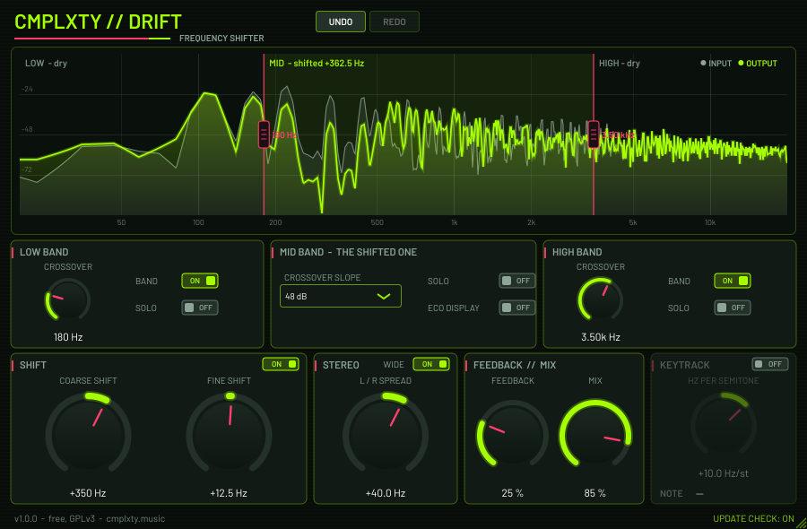

# CMPLXTY Drift

Free selective-band frequency shifter by CMPLXTY. Split the signal into low / mid / high with two crossovers, and shift only the middle band
up or down by a fixed number of Hz (not semitones), so the lows stay solid and the highs stay clean while the middle drifts, rings and goes
metallic or detuned. **VST3 + CLAP**, Windows x64 (installer built and tested under Wine only, see *Status*). macOS and Linux build from
the same source. Licence: **GNU GPL v3** (see `COPYING`). Download page: https://cmplxty.music/plugins/drift-shifter/



## Features
- **Spectrum + crossovers**: a live input/output analyser (log axis 20 Hz to 20 kHz) with two draggable crossover handles. Double-click a
  handle to reset it, right-click it for its menu. Crossover slope is 24, 48 or 96 dB/oct (Linkwitz-Riley; the bands sum flat when nothing is shifted).
- **Bands**: switch the low or the high band off and the shifter works on everything that is left (with both off it shifts the full signal).
  Solo low, mid or high to hear one band on its own.
- **Shift**: coarse shift (+-10 kHz, finer near zero) plus fine shift (+-500 Hz). Single-sideband shifting with a zero-latency IIR Hilbert pair.
  **The default shift is 0 Hz**: a fresh instance is transparent until you turn it.
- **Stereo**: L/R spread (+-500 Hz; left and right are shifted half of it each, in opposite directions) with a Wide switch.
- **Feedback // Mix**: feedback through the shifter (0-95 %, for barber-pole and ringing sweeps) and a dry/wet mix of the shifted band.
- **Keytrack**: optional; MIDI notes move the shift by a set number of Hz per semitone (+-100 Hz/st) from middle C.
- **Eco display**: lighter analyser (smaller FFT, lower frame rate) for slow machines.
- 18 parameters, all smoothed and host-automatable; no allocation on the audio thread; zero latency. Undo/redo buttons. Double-click a knob to reset it.
  Right-click any knob, switch, list or crossover handle for a menu (**Reset**, **Type in value**, **Copy / Paste**, **Automate**, **Init all**;
  shortcut letters are underlined). In VST3 hosts that offer it, the host's own parameter menu (e.g. create automation clip) is shown in that menu too.
- Resizable window (fixed aspect ratio, 60 % to 240 %); the size and every band setting are saved with the project and with presets.
- The editor never takes the keyboard focus, so **Space and other transport keys always reach the host** (also after a click on a knob,
  its value, a list or a menu).
- Silent, optional **update notice**: at most one `GET https://cmplxty.music/plugins/drift-shifter/version.json` per 24 h on a background
  thread; no identifiers sent; nothing is downloaded or run (the *Update* button opens the web page); Update / Later / Skip this version;
  can be switched off in the UI. Settings live in `%APPDATA%\CMPLXTY\Drift` (Windows).

## Install (users)
Download the installer from the web page: `CMPLXTY-Drift-Setup-<version>-win.exe` (Windows) or `...-mac.pkg` (macOS).
Windows: installs for all users (UAC prompt) to `C:\Program Files\Common Files\VST3` and `...\CLAP`, or for the current user only
if you decline; installing a newer version over an old one needs no uninstall and keeps your settings. Uninstall from *Apps & features*.
The installers are **unsigned**, so Windows SmartScreen / macOS Gatekeeper may warn.

## Build (developers)
```
scripts/fetch-deps.sh                    # clones JUCE 9.0.4 + clap-juce-extensions (pinned) into ext/ and applies patches/
# Linux (needs ALSA, FreeType, fontconfig, X11, Xrandr, Xinerama, Xcursor, Xi, Xcomposite, Xext, GL dev packages, Ninja)
cmake -S . -B build/linux -G Ninja -DCMAKE_BUILD_TYPE=Release -DJUCE_BUILD_EXAMPLES=OFF -DJUCE_BUILD_EXTRAS=OFF -DCLAP_JUCE_EXTENSIONS_BUILD_EXAMPLES=OFF
cmake --build build/linux --target Drift_VST3 Drift_CLAP
# Windows installer, cross-built on Linux (clang-cl + xwin, static CRT) - see header of the script for one-time setup
scripts/build-windows-xwin.sh && scripts/build-installer.sh      # -> dist/CMPLXTY-Drift-Setup-<version>-win.exe  (needs makensis)
# macOS (on a Mac)
scripts/build-macos-pkg.sh                                       # -> dist/CMPLXTY-Drift-Setup-<version>-mac.pkg
```
The version comes from `project(Drift VERSION x.y.z)` in `CMakeLists.txt`. CI: `ci/drift-shifter.yml`
(install as `.github/workflows/drift-shifter.yml` at the repository root).

### Patches (`patches/`)
- `juce-9.0.4-windows-fixes.patch`: JUCE otherwise links `TaskDialogIndirect` statically, which pulls in comctl32 v6 and stops the plug-in
  from loading in hosts that use the old comctl32 (e.g. FL Studio); now resolved at run time with a `MessageBoxW` fallback. Also: the VBlank
  thread now exits when `WaitForVBlank` fails (editor close hung under Wine / virtual / remote displays).
- `clap-juce-extensions-state-rescan.patch`: request a parameter rescan after state load so hosts refresh the displayed values.

### Tests
`test/dsp_test.cpp` (126 DSP checks: crossover sum / null, shift accuracy and sideband rejection, spread, feedback stability, keytrack, solo/band
routing, block-size independence, NaN/denormal safety), `test/update_test.cpp` (+ `test/update_server.py`, the network path; 73 + 18 checks), `test/screenshot.cpp` (renders the real editor to a PNG;
mode `keys` runs the keyboard-focus and right-click-menu audits and fails if the editor would take host keys). Validated with pluginval (strictness 5) and clap-validator on Linux.

## Status
Windows binaries are cross-compiled; the plug-in, host-load and installer were exercised under Wine only, **never on real Windows**
(UAC and SmartScreen untestable there). The macOS build has not been run at all. Installers are unsigned.

Third-party: JUCE 9.0.4 (GPLv3), VST3 SDK interface (GPLv3 / Steinberg), CLAP + clap-juce-extensions (MIT), Barlow font (SIL OFL 1.1).
