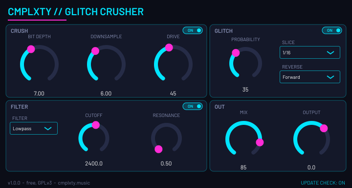

# CMPLXTY Glitch Crusher

Free bit-crusher / sample-rate reducer / tempo-synced glitch stutter / filter effect plug-in by CMPLXTY.
**VST3 + CLAP**, Windows x64 (installer built and tested under Wine only - see *Status*), macOS and Linux build from the same source.
Licence: **GNU GPL v3** (see `COPYING`). Download page: https://cmplxty.music/plugins/glitch-crusher/



## Features
- **Crush**: drive (tanh), sample-rate reduction (hold, 1-64x) and bit depth (1-16 bit, fractional), cross-faded on/off switch.
- **Glitch**: tempo-synced stutter (1/4, 1/8, 1/16, 1/32), probability, forward / reverse / random reverse. Follows host transport.
- **Filter**: state-variable low-pass / high-pass with cutoff and resonance.
- **Out**: dry/wet mix and output gain.
- Every knob and every section switch is host-automatable. Double-click a knob to reset it; right-click opens a menu
  (reset, type a value, copy / paste, **Automate**, init all; shortcut letters underlined; in VST3 hosts that offer it, the host's own parameter
  menu - e.g. create automation clip - is shown there too). The editor never keeps keyboard focus, so Space and other transport keys reach the host.
- Silent, optional **update notice**: at most one `GET https://cmplxty.music/plugins/glitch-crusher/version.json` per 24 h on a background
  thread; no identifiers sent; nothing is downloaded or run (the *Update* button opens the web page); can be switched off in the UI.
  Settings live in `%APPDATA%\CMPLXTY\Glitch Crusher` (Windows).

## Install (users)
Download the installer from the web page: `CMPLXTY-Glitch-Crusher-Setup-<version>-win.exe` (Windows) or `...-mac.pkg` (macOS).
Windows: installs for all users (UAC prompt) to `C:\Program Files\Common Files\VST3` and `...\CLAP`, or for the current user only
if you decline; installing a newer version over an old one needs no uninstall and keeps your settings. Uninstall from *Apps & features*.
The installers are **unsigned**, so Windows SmartScreen / macOS Gatekeeper may warn.

## Build (developers)
```
scripts/fetch-deps.sh                    # clones JUCE 9.0.4 + clap-juce-extensions (pinned) into ext/ and applies patches/
# Linux (needs ALSA, FreeType, fontconfig, X11, Xrandr, Xinerama, Xcursor, Xi, Xcomposite, Xext, GL dev packages, Ninja)
cmake -S . -B build/linux -G Ninja -DCMAKE_BUILD_TYPE=Release -DJUCE_BUILD_EXAMPLES=OFF -DJUCE_BUILD_EXTRAS=OFF -DCLAP_JUCE_EXTENSIONS_BUILD_EXAMPLES=OFF
cmake --build build/linux --target GlitchCrusher_VST3 GlitchCrusher_CLAP
# Windows installer, cross-built on Linux (clang-cl + xwin, static CRT) - see header of the script for one-time setup
scripts/build-windows-xwin.sh && scripts/build-installer.sh      # -> dist/CMPLXTY-Glitch-Crusher-Setup-<version>-win.exe  (needs makensis)
# macOS (on a Mac)
scripts/build-macos-pkg.sh                                       # -> dist/CMPLXTY-Glitch-Crusher-Setup-<version>-mac.pkg
```
The version comes from `project(GlitchCrusher VERSION x.y.z)` in `CMakeLists.txt`. CI: `ci/glitch-crusher.yml`
(install as `.github/workflows/glitch-crusher.yml` at the repository root).

### Patches (`patches/`)
- `juce-9.0.4-windows-fixes.patch`: JUCE otherwise links `TaskDialogIndirect` statically, which pulls in comctl32 v6 and stops the plug-in
  from loading in hosts that use the old comctl32 (e.g. FL Studio); now resolved at run time with a `MessageBoxW` fallback. Also: the VBlank
  thread now exits when `WaitForVBlank` fails (editor close hung under Wine / virtual / remote displays).
- `clap-juce-extensions-state-rescan.patch`: request a parameter rescan after state load so hosts refresh the displayed values.

### Tests
`test/dsp_test.cpp` (118 DSP checks), `test/update_test.cpp` (+ `test/update_server.py`, the network path; 73 + 18 checks),
`test/screenshot.cpp` (renders the real editor to a PNG). Validated with pluginval (strictness 5) and clap-validator on Linux.

## Status
Windows binaries are cross-compiled; the plug-in, host-load and installer were exercised under Wine only, **never on real Windows**
(UAC and SmartScreen untestable there). The macOS build has not been run at all. Installers are unsigned.

Third-party: JUCE 9.0.4 (GPLv3), VST3 SDK interface (GPLv3 / Steinberg), CLAP + clap-juce-extensions (MIT), Barlow font (SIL OFL 1.1).
