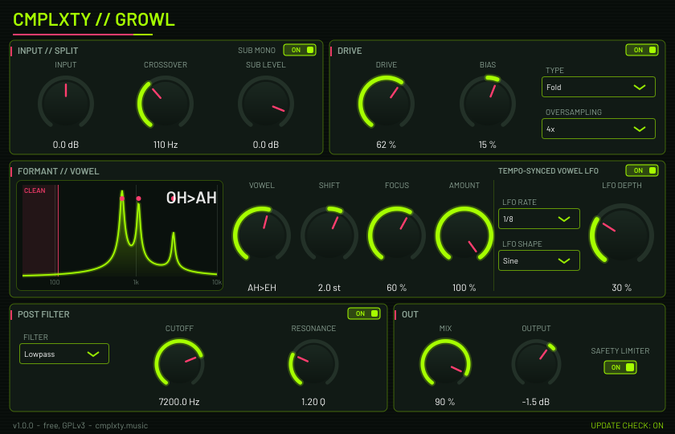

# CMPLXTY Growl

Free bass growl saturator by CMPLXTY: a clean mono sub, five saturation types, and a tempo-synced vowel (formant) filter for talking, growling and
screaming bass. **VST3 + CLAP**, Windows x64 (installer built and tested under Wine only - see *Status*), macOS and Linux build from the same source.
Licence: **GNU GPL v3** (see `COPYING`). Download page: https://cmplxty.music/plugins/growl-saturator/



## Features
- **Input // Split**: input gain and a steep (48 dB/oct, Linkwitz-Riley 8) crossover at 60-200 Hz. The low band stays clean (optionally summed to mono),
  only the high band gets the growl. *Sub level* trims the clean low band, *Sub mono* keeps it centred.
- **Drive**: five saturation types - **Tanh** (smooth), **Tube** (asymmetric, even harmonics), **Fold** (wavefolder), **Hard clip**, **Diode** -
  with drive and bias, and **Off / 2x / 4x oversampling** (half-band polyphase FIR; the reported latency is the same in all three modes).
- **Formant // Vowel**: three parallel band-pass formants morphing across OO - OH - AH - EH - EE, with formant shift (+-12 st), focus (Q), amount,
  and a **tempo-synced vowel LFO** (1/1 to 1/32; sine, triangle, saw up/down, square; follows the host tempo and position).
- **Post filter**: low-pass / high-pass with cutoff and resonance.
- **Out**: dry/wet mix (exact null at 0 %), output gain and a soft safety limiter.
- 24 parameters, all smoothed and host-automatable; no allocation on the audio thread. Double-click a knob to reset it; right-click any knob or
  section switch for a menu (**Reset**, **Type in value**, **Copy / Paste**, **Automate**, **Init all**; shortcut letters are underlined). In VST3
  hosts that offer it, the host's own parameter menu (e.g. create automation clip) is shown in that menu too.
- The editor never keeps the keyboard focus, so **Space and other transport keys always reach the host**.
- Silent, optional **update notice**: at most one `GET https://cmplxty.music/plugins/growl-saturator/version.json` per 24 h on a background
  thread; no identifiers sent; nothing is downloaded or run (the *Update* button opens the web page); can be switched off in the UI.
  Settings live in `%APPDATA%\CMPLXTY\Growl` (Windows).

## Install (users)
Download the installer from the web page: `CMPLXTY-Growl-Setup-<version>-win.exe` (Windows) or `...-mac.pkg` (macOS).
Windows: installs for all users (UAC prompt) to `C:\Program Files\Common Files\VST3` and `...\CLAP`, or for the current user only
if you decline; installing a newer version over an old one needs no uninstall and keeps your settings. Uninstall from *Apps & features*.
The installers are **unsigned**, so Windows SmartScreen / macOS Gatekeeper may warn.

## Build (developers)
```
scripts/fetch-deps.sh                    # clones JUCE 9.0.4 + clap-juce-extensions (pinned) into ext/ and applies patches/
# Linux (needs ALSA, FreeType, fontconfig, X11, Xrandr, Xinerama, Xcursor, Xi, Xcomposite, Xext, GL dev packages, Ninja)
cmake -S . -B build/linux -G Ninja -DCMAKE_BUILD_TYPE=Release -DJUCE_BUILD_EXAMPLES=OFF -DJUCE_BUILD_EXTRAS=OFF -DCLAP_JUCE_EXTENSIONS_BUILD_EXAMPLES=OFF
cmake --build build/linux --target Growl_VST3 Growl_CLAP
# Windows installer, cross-built on Linux (clang-cl + xwin, static CRT) - see header of the script for one-time setup
scripts/build-windows-xwin.sh && scripts/build-installer.sh      # -> dist/CMPLXTY-Growl-Setup-<version>-win.exe  (needs makensis)
# macOS (on a Mac)
scripts/build-macos-pkg.sh                                       # -> dist/CMPLXTY-Growl-Setup-<version>-mac.pkg
```
The version comes from `project(Growl VERSION x.y.z)` in `CMakeLists.txt`. CI: `ci/growl-saturator.yml`
(install as `.github/workflows/growl-saturator.yml` at the repository root).

### Patches (`patches/`)
- `juce-9.0.4-windows-fixes.patch`: JUCE otherwise links `TaskDialogIndirect` statically, which pulls in comctl32 v6 and stops the plug-in
  from loading in hosts that use the old comctl32 (e.g. FL Studio); now resolved at run time with a `MessageBoxW` fallback. Also: the VBlank
  thread now exits when `WaitForVBlank` fails (editor close hung under Wine / virtual / remote displays).
- `clap-juce-extensions-state-rescan.patch`: request a parameter rescan after state load so hosts refresh the displayed values.

### Tests
`test/dsp_test.cpp` (112 DSP checks: crossover sum / null, saturator curves, oversampling latency, formant response, LFO sync, limiter, NaN/denormal
safety), `test/update_test.cpp` (+ `test/update_server.py`, the network path; 73 + 18 checks), `test/screenshot.cpp` (renders the real editor to a PNG;
mode `keys` runs the keyboard-focus and right-click-menu audits and fails if the editor would take host keys). Validated with pluginval (strictness 5) and clap-validator on Linux.

## Status
Windows binaries are cross-compiled; the plug-in, host-load and installer were exercised under Wine only, **never on real Windows**
(UAC and SmartScreen untestable there). The macOS build has not been run at all. Installers are unsigned.

Third-party: JUCE 9.0.4 (GPLv3), VST3 SDK interface (GPLv3 / Steinberg), CLAP + clap-juce-extensions (MIT), Barlow font (SIL OFL 1.1).
