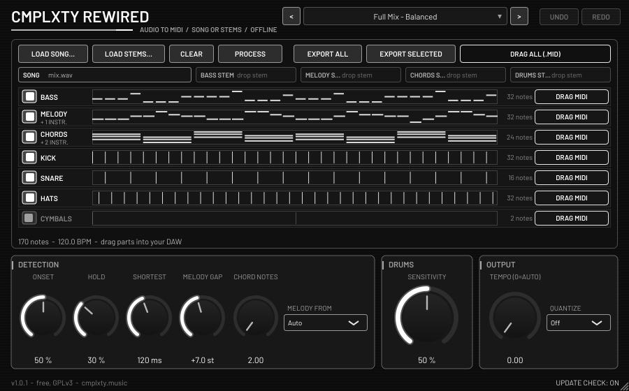

# CMPLXTY Rewired

Free **offline audio-to-MIDI** by CMPLXTY. You can load a finished song, or load the separate stems if you have them. Press **Process** and Rewired writes
**Bass, Melody, Chords** and **Drums** as MIDI parts. The drums come split into **Kick, Snare, Hats** and **Cymbals**, on channel 10 with General MIDI notes.
Export one MIDI file with a named track per part, or only the parts you selected. You can also drag a single part, or all of them, straight onto a DAW
track. In FL Studio you drop it on the playlist or the piano roll.
Formats: **VST3 + CLAP + Standalone app**. Windows x64 is cross-built here and its installer is not yet tested on a real PC. macOS builds from the same source in CI (untested on a real Mac).
Everything runs on the CPU and nothing is uploaded. Licence: **GNU GPL v3** (see `COPYING`). Download page: https://cmplxty.music/plugins/rewired/



## Why a Standalone app as well as the plug-in
Transcription is offline work. A song is read from a file, separated into stems and analysed in about 5 s per 30 s of audio, so it has nothing to do with
the DAW's audio stream. The models are about 80 MB, and you may want to transcribe a song without opening a project, so a small app is the most
natural home for it. Rewired also runs as a VST3/CLAP plug-in, because dragging the parts straight into a DAW track is the fastest workflow. The plug-in
passes audio through untouched. All three formats share one copy of the models.

## How to use
1. Press **Load song...**, or drag an audio file onto the SONG box (or anywhere on the window). WAV, AIFF, FLAC, OGG and MP3 work, up to 15 minutes. If you have stems, press **Load stems...**
   or drag a file onto the BASS / MELODY / CHORDS / DRUMS box it belongs in (the box lights up while you hover). Several files dropped at once are sorted by name: names containing bass/808/sub, drum/perc/kick/beat and vocal/vox/lead/melody are recognised, horn/brass/string/piano/keys/guitar/synth/pad go to Chords, and unnamed files fill the empty boxes. Loading a song clears the stems, and loading stems clears the song.
2. Press **Process**. A progress bar is shown and you can **Cancel**. In song mode the mix is first separated into vocals / drums / bass / other with Spleeter.
3. Switch parts on or off with the toggles. **Export All** writes `Documents/CMPLXTY Rewired/<song>/<song>.mid`, with 7 named tracks and tempo.
   **Export Selected** writes only the parts that are switched on. You can also drag a part's **DRAG MIDI** chip, or **DRAG ALL**, onto a track.

4. **Instruments (1.0.1):** under Bass, Melody and Chords a "+ N INSTR." line opens best-guess instrument sub-tracks (Horns, Winds, Strings,
   Piano / Keys, Organ, Guitar, Mallets / Bells, Synth, Vocals, Bass Guitar, Upright Bass / Synth Bass). Each has its own **DRAG MIDI** chip, and the
   exported file splits the part into one named track per instrument with a matching GM program. Labels are a guess from the sound and are shown as
   "guess NN%"; a stem whose file name names the instrument (e.g. "Horns.wav") uses that name instead. They are much more reliable from stems than from a full mix.

## Controls
- **Note Onset / Note Hold**: how readily notes start and how long they are held. Low values give more notes.
- **Shortest Note** (30-400 ms). **Melody Gap** (3-12 semitones): a note this far above the accompaniment counts as melody.
  **Chord Notes** (2-4): the fewest notes sounding together that count as a chord.
- **Melody source**: Auto, Vocals, or Instruments (the separated vocals, the "other" stem, or whichever is stronger).
- **Drum Sensitivity**. **Tempo**: 0 = auto-detect. **Quantize**: Off, 1/16, 1/8 or 1/4.
- **14 factory presets** (Full Mix, Stems, Rap, Piano/Keys, EDM, Rock...) plus user presets. Inputs, settings and the result are saved with the project.
- Monochrome UI. Right-click any control for its menu (Reset, Type in value, Copy/Paste, Automate). The editor never takes keyboard focus, so **Space reaches the host**.
- Optional **update notice**: at most one `GET https://cmplxty.music/plugins/rewired/version.json` per 24 h, on a background thread. It reads the `mac` block on macOS.
  It is silent on failure, sends no identifiers, and can be switched off.

## How it works
- **Separation:** Deezer **Spleeter 4stems** (MIT code and weights). It was converted from the official TF checkpoint to ONNX by `tools/spleeter_to_onnx.py`, with max abs diff 1.4e-3 against the original.
- **Notes:** Spotify **basic-pitch 0.4.0** (`nmp.onnx`, Apache-2.0) runs on the bass, vocals and "other" stems. Bass is taken as monophonic lowest notes. Melody is the top line
  (from the vocals or instruments) that stands at least Melody Gap above the rest. Chords are the remaining notes, grouped where Chord Notes or more sound together.
- **Drums:** band-split spectral flux on the drums stem: kick in the low band, snare in the mid/body band with noise, and hats in the high band. Cymbals are high-band hits with a long ring-out.
- **Instruments:** Google **YAMNet** (Apache-2.0, ~15 MB ONNX, `models/instruments.onnx`) tags each note's audio; a small head trained on rendered
  soundfont clips (FluidR3_GM, TimGM6mb; training only, not shipped) maps the 521 AudioSet classes to 11 groups. Bass uses the raw YAMNet classes. See `tools/instruments/`.
- **Tempo:** autocorrelation of the onset envelope. It is used for the MIDI tempo and for quantizing.
- **Runtime:** ONNX Runtime 1.23.2 (MIT), CPU only. It is loaded at run time from the model folder, is never linked, and is renamed `cmplxty-rewired-ort.dll` on Windows.
  The model folders are Windows `Common Files\CMPLXTY\Rewired` (per-user: `%LOCALAPPDATA%\Programs\Common\CMPLXTY\Rewired`) and macOS `/Library/Application Support/CMPLXTY/Rewired`.

## Install (users)
Windows: run `CMPLXTY-Rewired-Setup-<version>-win.exe`. It installs the VST3, the CLAP, the app (in the Start menu) and the models.
macOS: see `HOW-TO-OPEN-ON-MAC.md`. The installers are **unsigned**.

## Build (developers)
```
scripts/fetch-deps.sh
scripts/fetch-models.sh        # -> build/models (needs python3 + tensorflow-cpu + onnx for the Spleeter conversion)
cmake -S . -B build/linux -G Ninja -DCMAKE_BUILD_TYPE=Release -DJUCE_BUILD_EXAMPLES=OFF -DJUCE_BUILD_EXTRAS=OFF -DCLAP_JUCE_EXTENSIONS_BUILD_EXAMPLES=OFF
cmake --build build/linux --target Rewired_VST3 Rewired_CLAP Rewired_Standalone
RW_MODEL_DIR=build/models ...  # point a Linux build at the models (plus ort/linux/libonnxruntime.so.1.23.2 copied in)
RW_MODELS=build/models RW_ORT_WIN=build/models/ort/win-x64/onnxruntime.dll scripts/build-windows-xwin.sh && scripts/build-installer.sh
scripts/build-macos-pkg.sh     # on a Mac
```

### Tests
- `test/dsp_test.cpp` (no models needed): resampling, tempo, drum split on a synthetic loop, melody/chord split, monophonic bass, quantize, errors, speed.
- `test/screenshot.cpp` (`proc` mode, needs the models): passthrough, inputs, real runs in song and stems modes, cancel, export (7 named tracks / selected / one part),
  drums on channel 10, state round trip, presets.
- `test/eval.py` scores against reference MIDI with **mir_eval**: note-onset P/R/F1 (50 ms, 50 cents) for pitched parts and onset F for drums.
  `test/make_songs.py` renders the 6 synthetic test songs (GM-style bass, lead, pads, drums), and their stems, from known MIDI.
  Mean F1 on these songs: **song mode 0.836**, **stems mode 0.943** (see NOTES). Real recordings will score lower, especially melody and chords in full mixes.
- Validated with pluginval (strictness 5) and clap-validator on Linux.
