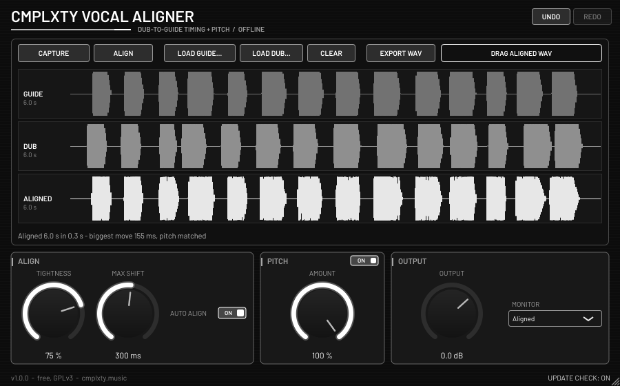

# CMPLXTY Vocal Aligner

Free offline dub-to-guide vocal aligner by CMPLXTY. Capture (or load) a guide take and a dub take, press **Align**, and the dub's timing,
and optionally its pitch, is pulled onto the guide. The aligned take plays back in place in your DAW, or you can export it or drag it out
as a WAV. Inspired by the classic "align the double to the lead" workflow. It is its own design and not a clone of any product.
**VST3 + CLAP**, Windows x64 (installer built and tested under Wine only). macOS and Linux build from the same source.
Licence: **GNU GPL v3** (see `COPYING`). Download page: https://cmplxty.music/plugins/vocal-aligner/



## How to use
1. Put the plug-in on the dub track. Route the guide (lead) track to its **side-chain** input. Or load the guide from a file with **Load guide...**.
2. Press **Capture** and play the section. The dub (main input) and the guide (side-chain) are recorded against the song position. Press **Stop**.
   You can also load the dub from a file or drop audio files on the guide and dub lanes.
3. Press **Align**. With **Auto align** on, this happens right after capture. Alignment runs on a background thread. Up to 5 minutes per take.
4. Play the song. Inside the captured range the plug-in outputs the aligned take in place of the input (**Monitor**: Aligned / Original / Guide).
   **Export WAV** writes `Documents/CMPLXTY Vocal Aligner/Aligned dub <date>.wav` (24-bit, padded so it starts at the take's song position).
   You can also drag the **Drag aligned WAV** chip straight onto a DAW track.

## Controls
- **Tightness**: how closely the dub follows the guide's timing (low = loose, natural; high = tight).
- **Max shift**: the largest timing move allowed (10-1000 ms).
- **Pitch** (on/off) + **Amount**: moves the dub's pitch toward the guide's (0-100 %).
- **Output** gain, **Monitor** source, **Auto align**.
- Takes and the aligned result are saved with the project (FLAC-compressed), so you can re-align later.
- Monochrome UI. Undo/redo. Double-click a knob to reset it. Right-click any control for its menu (**Reset**, **Type in value**,
  **Copy / Paste**, **Automate**, **Init all**; shortcut letters underlined). The editor never takes keyboard focus, so **Space reaches the host**.
- Optional **update notice**: at most one `GET https://cmplxty.music/plugins/vocal-aligner/version.json` per 24 h, on a background thread.
  It is silent on failure and sends no identifiers. Choices: Update / Later / Skip this version, and you can switch it off in the UI.

## Algorithm (short)
Log-band spectral + loudness features every 10 ms. Banded dynamic time warping (within ±Max shift) gives a monotonic, smoothed warp map.
The dub is rendered with WSOLA time-warping. For pitch, YIN tracks both takes, and each grain is resampled toward the guide's pitch.

## Install (users)
Windows: run `CMPLXTY-Vocal-Aligner-Setup-<version>-win.exe`. Installing over an old version updates it in place and keeps your settings.
macOS: see `HOW-TO-OPEN-ON-MAC.md`. The installers are **unsigned**.

## Build (developers)
```
scripts/fetch-deps.sh
cmake -S . -B build/linux -G Ninja -DCMAKE_BUILD_TYPE=Release -DJUCE_BUILD_EXAMPLES=OFF -DJUCE_BUILD_EXTRAS=OFF -DCLAP_JUCE_EXTENSIONS_BUILD_EXAMPLES=OFF
cmake --build build/linux --target VocalAligner_VST3 VocalAligner_CLAP
scripts/build-windows-xwin.sh && scripts/build-installer.sh   # Windows installer (cross-built)
scripts/build-macos-pkg.sh                                    # macOS
```

### Tests
- `test/dsp_test.cpp`: onset error 43.8 → 2.1 ms on a jittered phrase. Pitch error -40 → -3 cents, and 50 % amount gives about half.
  Also covers identity, silence, too-short input, cancel and 44.1 kHz.
- `test/update_test.cpp`: the update notice.
- `test/screenshot.cpp`: modes `keys` (focus and menu audit) and `proc`. `proc` covers side-chain capture through processBlock, auto align,
  in-place playback, monitor modes, export, state round trip, re-align with pitch, and file loading.
- Validated with pluginval (strictness 5) and clap-validator on Linux.
